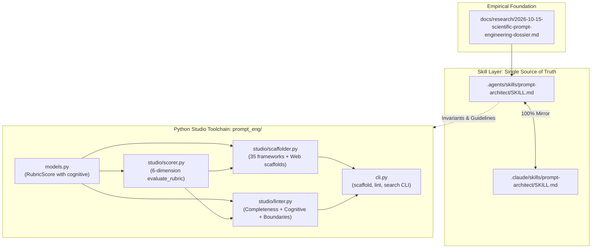
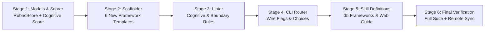

# Design Specification: Scientific Prompt Architect Upgrade

**File**: `docs/superpowers/specs/2026-10-15-scientific-prompt-architect-upgrade-design.md`  
**Author**: `0xrizz`  
**Date**: October 15, 2026  
**Status**: APPROVED (Pending Implementation Planning)  
**Version**: 1.0.0  
**Grounded In**: `docs/research/2026-10-15-scientific-prompt-engineering-dossier.md`  

---

## 1. Executive Summary & Problem Statement

Following our empirical research dossier ([2026-10-15-scientific-prompt-engineering-dossier.md](../../research/2026-10-15-scientific-prompt-engineering-dossier.md)), we are upgrading the **Prompt Studio Hub** (`prompt-engineer`) into a scientifically grounded prompt engineering platform.

Current limitations in prompt engineering tooling:
1. **Linear Reasoning Bias**: Existing frameworks (e.g. CoT, ReAct) assume linear chains or simple trees, failing on complex multi-branch engineering tasks that require non-linear DAG aggregation (Graph-of-Thoughts) or decoupled agentic specialist coordination (Meta-Prompting).
2. **Cognitive Degradation ("Lost in the Middle")**: Prompts exceeding several hundred tokens suffer up to a 30% drop in instruction recall when critical constraints are placed in the middle rather than anchored at the Head (primacy) and Tail (recency).
3. **Negative Constraint Failure ("Pink Elephant Paradox")**: Prompts relying on naive negative lists ("do not", "never") trigger token priming in transformer attention, paradoxically increasing violation rates.
4. **Repository Context Bloat**: Dumping raw JSX/AST code into prompts burns thousands of tokens on presentation noise rather than interface contracts.
5. **Modern Full-Stack Execution Ambiguity**: LLMs routinely blur the boundary between Server Components (`RSC`), Client Components (`'use client'`), and Server Actions (`'use server'`), causing credential leaks and hydration mismatches.

This specification locks the architecture, interfaces, and testing strategy for upgrading both the agent skill (`prompt-architect`) and the CLI engine (`prompt-eng`).

---

## 2. Goals & Non-Goals

### Goals
- **Expand Framework Catalog (31 → 35)**: Formally integrate Graph-of-Thoughts (GoT), Meta-Prompting, Buffer-of-Thoughts (BoT), and Medprompt / Dynamic Few-Shot Ensembling into `.agents/skills/prompt-architect/SKILL.md` (and shadowed `.claude/skills/`).
- **6-Dimension Cognitive Rubric**: Upgrade the 5-dimension rubric in the skill and in `prompt_eng/studio/scorer.py` by adding *Attention & Cognitive Dynamics* (Sandwich structuring and contrastive positive steering).
- **Web Codebase & Defense-in-Depth Contracts**: Formally embed the 3-stage prompting pipeline, TypeScript interface stub slicing, execution boundary declarations, WCAG 2.2 AA / ARIA 1.2 rules, and OWASP Top 10 security guardrails.
- **Python CLI Scaffolder Upgrade**: Enable `prompt-eng scaffold --framework <fw>` to natively generate scaffolds for `GOT`, `META-PROMPTING`, `BOT`, `MEDPROMPT`, `WEB-ACCESSIBLE`, and `DEFENSIVE-ACTION`.
- **Python CLI Linter Upgrade**: Add rules to `prompt-eng lint` for framework completeness (`ERR-FRAMEWORK-INCOMPLETE`), sandwich architecture (`WARN-SANDWICH-STRUCTURE`), naive negative constraint clusters (`WARN-NAIVE-NEGATION`), and client-side secret leakage (`WARN-CLIENT-SECRET-LEAK`).
- **Zero Runtime Dependencies**: Maintain 100% Python 3.14 standard library (`dependencies = []`).
- **Fast Offline Tests**: Ensure all existing and new unit tests run offline in $< 2.5$ seconds.

### Non-Goals
- Modifying prompt engineering frameworks unrelated to our research dossier.
- Introducing heavy external parsers (e.g. tree-sitter or external AST tools); all linting relies on high-speed standard library regular expressions and text parsing.
- Creating an external database; all profiles and catalogs remain lightweight YAML/JSON files.

---

## 3. Architecture & Component Boundaries



---

## 4. Detailed Component Specifications

### 4.1 Skill Layer (`.agents/skills/prompt-architect/SKILL.md`)

1. **Frontmatter**:
   - `author`: `0xrizz`
   - `version`: `"4.0.0"`
   - `description`: Update description to state: `"Use when analyzing and improving prompts using 35 frameworks across 7 intent categories..."`
2. **Intent Framework Additions**:
   - **CREATE**: Add **Graph-of-Thoughts (GoT)** (Signal: *Non-linear multi-branch problem, DAG topology, combining and refining alternative architectures*).
   - **TRANSFORM**: Add **Buffer-of-Thoughts (BoT)** (Signal: *Repeated/templated reasoning pattern, retrieve and instantiate distilled thought-template from meta-buffer*).
   - **REASON**:
     - **GoT** (Besta et al., arXiv:2308.09687)
     - **Meta-Prompting** (Suzgun & Kalai, arXiv:2401.12954; Signal: *Conductor-orchestrated fresh-context specialist agents*)
     - **BoT** (Yang et al., arXiv:2406.04271)
     - **Medprompt / Dynamic Few-Shot Ensembling** (Nori et al., arXiv:2311.16452; Signal: *High-stakes reasoning, dynamic exemplar retrieval, choice-shuffle ensembling*)
3. **Cognitive Rubric (6 Dimensions)**:
   - Clarity, Specificity, Context, Completeness, Structure.
   - **Attention & Cognitive Dynamics (New)**:
     - Head Anchor (10%): Role, invariants, and core constraints.
     - Body (80%): Passive context, file snippets, stubs.
     - Tail Anchor (10%): Immediate objective, expected output schema.
     - Contrastive Positive Steering: Set-theoretic replacement of negative prohibitions with positive bounded instructions ($T \subset \Omega$).
4. **Web Codebase Prompt Engineering Guide**:
   - 3-Stage Pipeline (Hierarchical Localization $\rightarrow$ Context Slicing $\rightarrow$ Targeted Generation).
   - TypeScript Interface Stub Slicing (contract stubs instead of raw AST / JSX dumps).
   - Execution Boundary Invariants (Server Component `RSC` vs Client Component `'use client'` vs Server Action `'use server'`).
   - Semantic HTML & WCAG 2.2 AA (anti-div-soup, visible focus indicators, dynamic ARIA states).
   - Zero-Trust Security (secret isolation, runtime Zod schema parsing, IDOR authorization, XSS sanitization).
5. **Skill Mirroring**:
   - Synchronize identical content to `.claude/skills/prompt-architect/SKILL.md`.

---

### 4.2 Models & Rubric Scorer (`prompt_eng/models.py`, `prompt_eng/studio/scorer.py`)

1. **`prompt_eng/models.py`**:
   - Update `RubricScore`:
     ```python
     @dataclass
     class RubricScore:
         clarity: float
         specificity: float
         context: float
         completeness: float
         structure: float
         cognitive: float | None = None
         overall: float | None = None

         def __post_init__(self) -> None:
             if self.overall is None:
                 if self.cognitive is not None:
                     self.overall = round(
                         (
                             self.clarity
                             + self.specificity
                             + self.context
                             + self.completeness
                             + self.structure
                             + self.cognitive
                         )
                         / 6.0,
                         1,
                     )
                 else:
                     self.overall = round(
                         (
                             self.clarity
                             + self.specificity
                             + self.context
                             + self.completeness
                             + self.structure
                         )
                         / 5.0,
                         1,
                     )
```
2. **`prompt_eng/studio/scorer.py`**:
   - In `evaluate_rubric(prompt_text)`:
     - Compute `cognitive` score (baseline 6.0):
       - If prompt has Head and Tail anchors (`## role|system` near top and `## output|expectation|return` near bottom), add `+2.0`.
       - If naive negation clusters appear without positive contrast, penalize `-1.5`.
       - Clamped between 1.0 and 10.0.
   - Update `render_rubric_table` to include `Cognitive Dynamics`.

---

### 4.3 Scaffolding Engine (`prompt_eng/studio/scaffolder.py`)

Extend `scaffold_prompt(profile, repo_name, prompt_name, framework)` to generate:
1. **`GOT`**:
   - Sections: `## Objective`, `## Graph Topology (DAG)`, `## Generation Nodes`, `## Aggregation & Scoring`, `## Refinement & Exit Criteria`.
2. **`META-PROMPTING`**:
   - Sections: `## Objective`, `## Conductor System Instructions`, `## Specialist Agent Personas`, `## Isolated Delegation Protocol`, `## Synthesis & Verification`.
3. **`BOT`**:
   - Sections: `## Objective`, `## Distilled Meta-Buffer Templates`, `## Problem Distillation`, `## Instantiated Solution Steps`, `## Verification`.
4. **`MEDPROMPT`**:
   - Sections: `## Objective`, `## Dynamic Few-Shot Exemplars`, `## Chain-of-Thought Formulation`, `## Choice-Shuffle Ensembling`, `## Final Verification`.
5. **`WEB-ACCESSIBLE`**:
   - Sections: `## Semantic Landmark Hierarchy`, `## Component Interface Stubs`, `## Keyboard & ARIA State Contracts`, `## Responsive Layout Tokens`.
6. **`DEFENSIVE-ACTION`**:
   - Sections: `## Boundary Contract (Server Action)`, `## Runtime Schema (Zod)`, `## Session Authorization (IDOR)`, `## Database Query Isolation`.

---

### 4.4 Linting Engine (`prompt_eng/studio/linter.py`)

Extend `lint_prompt(prompt_text, profile, framework, prompt_name, strict)`:
1. **Framework Completeness (`ERR-FRAMEWORK-INCOMPLETE`)**:
   - Add required section checks for `GOT`, `META-PROMPTING`, `BOT`, `MEDPROMPT`.
2. **Sandwich Structure Check (`WARN-SANDWICH-STRUCTURE`)**:
   - If prompt length $> 150$ words and lacks head anchor (`role`, `system`, `context`, `objective`) or tail anchor (`output`, `format`, `return`, `verify`, `steps`), emit a warning with suggestion to anchor execution criteria at the tail.
3. **Naive Negation Cluster Check (`WARN-NAIVE-NEGATION`)**:
   - Count unanchored negative phrases: `"do not"`, `"never"`, `"don't"`, `"cannot"`.
   - If count $\ge 3$ and ratio of positive keywords (`"must"`, `"only"`, `"use"`, `"require"`) is low, emit a warning suggesting contrastive positive steering.
4. **Client Secret Leak Check (`WARN-CLIENT-SECRET-LEAK`)**:
   - If prompt contains `'use client'` alongside `process.env.SECRET` or database tokens, emit a warning.
5. **Strict Mode Enforcement**:
   - In non-strict mode, only `ERROR` causes `is_valid = False`.
   - In strict mode (`--strict`), any `WARNING` also sets `is_valid = False`.

---

### 4.5 CLI Router (`prompt_eng/cli.py`)

- Update `scaffold` subparser choices and help message to list the newly supported frameworks (`GOT`, `META-PROMPTING`, `BOT`, `MEDPROMPT`, `WEB-ACCESSIBLE`, `DEFENSIVE-ACTION`).
- Update `lint` subparser help text to describe cognitive and web security validations.

---

## 5. Testing & Verification Plan

### Test Suites to Update / Create
1. **`tests/test_models.py`**:
   - Verify `RubricScore` with 5 dimensions (legacy) and 6 dimensions (`cognitive`).
2. **`tests/test_scaffolder.py`**:
   - Test scaffolding for `GOT`, `META-PROMPTING`, `BOT`, `MEDPROMPT`, `WEB-ACCESSIBLE`, `DEFENSIVE-ACTION`.
   - Test case insensitivity (`got`, `GoT`, `GOT`).
   - Verify rubric score inclusion in generated frontmatter.
3. **`tests/test_linter.py`**:
   - Test detection of missing sections in new frameworks.
   - Test `WARN-SANDWICH-STRUCTURE` on unstructured long prompts.
   - Test `WARN-NAIVE-NEGATION` on naive "don't" prompt clusters.
   - Test `WARN-CLIENT-SECRET-LEAK` on client-side secrets.
   - Test `--strict` mode behavior.
4. **`tests/test_skills_setup.py`**:
   - Assert `author: 0xrizz` and `version: "4.0.0"`.
   - Assert 35 frameworks catalog across `.agents/` and `.claude/`.
5. **`tests/test_cli.py`**:
   - End-to-end CLI integration test for `scaffold -f got` and `lint --strict`.

### Performance & Quality Gates
- `uv run pytest tests/`: 100% tests pass in $< 2.5$ seconds.
- `uv run ruff check .`: 0 errors.
- `uv run ruff format --check .`: 0 unformatted files.
- `git status`: Clean working tree.

---

## 6. Implementation Stages & Dependencies


